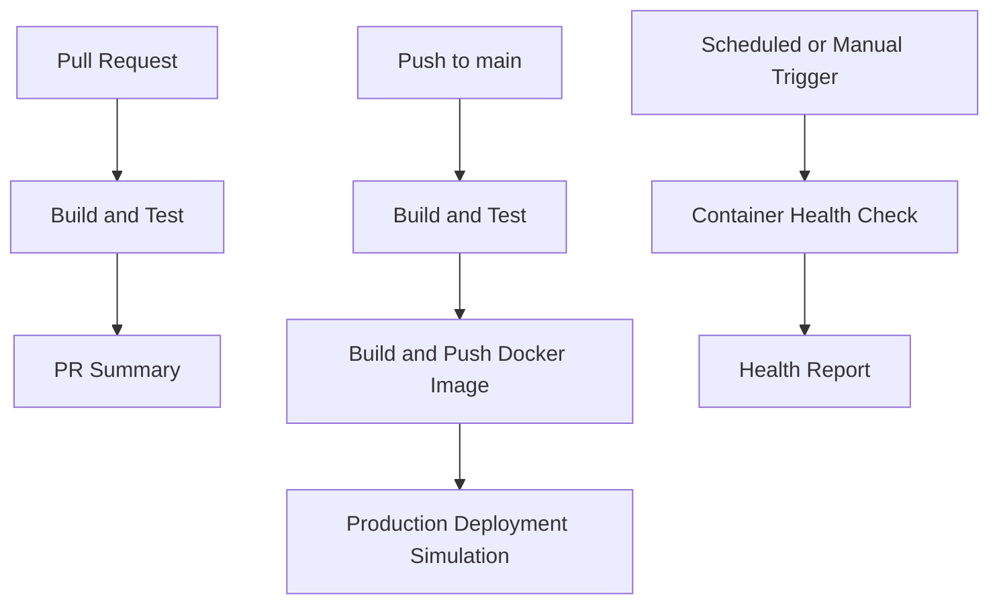

# GitHub Actions Capstone

An end-to-end CI/CD project using Flask, Pytest, Docker, Docker Hub, and GitHub Actions.

## Workflow Status


## Features

- Flask application with a health endpoint.
- Automated testing with Pytest.
- Reusable GitHub Actions workflows.
- Docker image publishing with `latest` and commit SHA tags.
- Pull request validation without Docker publishing.
- Main branch CI/CD with a production deployment simulation.
- Scheduled and manually triggered container health checks.

## Architecture



## Run Locally

Install dependencies:

```bash
python -m pip install -r requirements.txt
```

Run tests:

```bash
python -m pytest -v
```

Start the app:

```bash
python app.py
```

Open `http://localhost:5000/health` to check the health endpoint.

## Required Secrets

Configure `DOCKER_USERNAME` and `DOCKER_TOKEN` in the repository Actions secrets.


