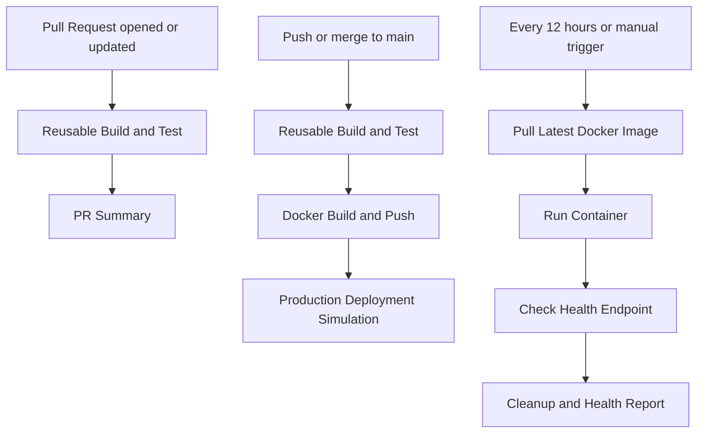

# Day 48 – GitHub Actions Capstone: End-to-End CI/CD Pipeline

## Objective

Build an end-to-end CI/CD pipeline using GitHub Actions, reusable workflows, automated tests, Docker Hub, and a production deployment stage.

## Project Stack

- Python and Flask
- Pytest for automated testing
- Docker for containerization
- GitHub Actions for CI/CD
- Docker Hub for image storage

## Application Endpoints

- `/` – Returns the application welcome message.
- `/health` – Returns the application health status.

## Workflows

### 1. Reusable Build and Test

File: `.github/workflows/reusable-build-test.yml`

- Checks out the repository.
- Sets up Python.
- Installs dependencies.
- Runs pytest when enabled.
- Exposes the test result as a reusable workflow output.

### 2. Reusable Docker Build and Push

File: `.github/workflows/reusable-docker.yml`

- Checks out the repository.
- Generates a seven-character commit SHA tag.
- Logs in to Docker Hub using GitHub Actions secrets.
- Builds and pushes the Docker image with `latest` and `sha-<short-sha>` tags.

### 3. Pull Request Pipeline

File: `.github/workflows/pr-pipeline.yml`

- Runs when a pull request is opened or synchronized against `main`.
- Executes the reusable build-and-test workflow.
- Prints a PR summary.
- Does not build or push Docker images.

### 4. Main Branch Pipeline

File: `.github/workflows/main-pipeline.yml`

- Runs on pushes to `main`.
- Executes tests first.
- Builds and pushes Docker images after tests pass.
- Runs a deployment simulation using the `production` environment.

### 5. Scheduled Health Check

File: `.github/workflows/health-check.yml`

- Runs every 12 hours using a cron schedule.
- Supports manual execution with `workflow_dispatch`.
- Pulls the latest Docker image.
- Starts a container and tests `/health`.
- Cleans up the container and writes a report to the Actions job summary.

## Pipeline Architecture

## Secrets

Configure the following repository secrets under Settings → Secrets and variables → Actions:

- `DOCKER_USERNAME`
- `DOCKER_TOKEN`

Never commit access tokens or credentials to the repository.

## Validation Checklist

- [ ] Flask application runs locally.
- [ ] Automated tests pass.
- [ ] Docker image builds and runs locally.
- [ ] Main pipeline passes on GitHub Actions.
- [ ] Pull request pipeline is verified without Docker publishing.
- [ ] Both Docker image tags are published.
- [ ] Scheduled health check passes.
- [ ] README workflow badges are visible.
- [ ] Successful pipeline screenshot is saved.

## What I Learned

- Reusable workflows reduce duplication.
- CI tests catch application issues before image publishing.
- Docker tags help identify specific application builds.
- GitHub Actions secrets protect credentials.
- Health checks provide an automated way to validate container behavior.
- Job dependencies enforce the intended CI/CD sequence.

## Future Improvements

- Add Trivy image vulnerability scanning.
- Configure production deployment with a real server.
- Add environment protection and required reviewers.
- Send Slack notifications for failed workflows.
- Implement rollback to a previous image tag.

## Conclusion

This capstone brings together GitHub Actions concepts learned during Days 40–47. It demonstrates a practical CI/CD workflow from automated testing through Docker publishing, deployment simulation, and scheduled health validation.
